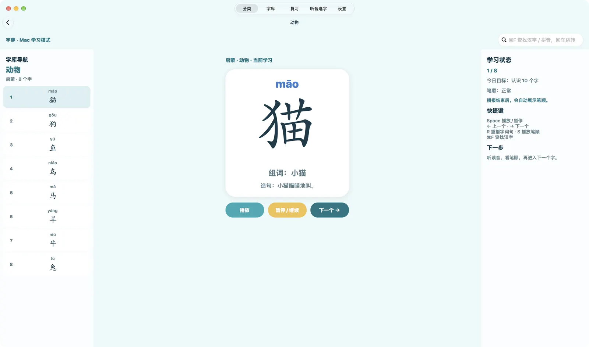

<h1 align="center">字芽 ZiYa</h1>

陪孩子一字一字认汉字 · iPhone / iPad / Mac 
<a href="https://ziya.vanjay.cn">主页</a> · <a href="https://github.com/wangwanjie/ZiYa/releases/latest">下载</a> · <a href="README.en.md">English</a>

字芽是给孩子的中文识字 App。每次只学一个字：看楷体大字和拼音，听字、组词和造句的朗读，再看笔顺动画；学过的字会进入复习，隔一段时间再出现。

## 有什么

- **字库**：3500 个常用字，按启蒙和一至六年级分成 46 个学习单元，也可以按身体、动物、植物、饮食、自然等 100 多个主题来学；可以用汉字、拼音或组词搜索。
- **学字卡**：楷体大字 + 拼音，依次朗读字、组词和造句，可重听、慢速播放；朗读结束后自动播放笔顺动画。部分常用字配有自然人声读音（AI 语音合成），其余使用系统离线语音。
- **复习**：打乱复习，或按类别、年级复习，学过的字按间隔再次出现。
- **听音选字**：家长设定题量（5–50 题）和难度（基础 / 进阶 / 挑战），题目只从孩子学过的字里出；答错先记录，做完再一起看错题。
- **成长报告与家长中心**：查看学习进度和错题记录，设定每日学习目标、考试默认和复习方式。
- **五套皮肤**：春芽、水墨、海屿、糖果、星夜。
- **Mac 键盘操作**：空格播放 / 暂停，← → 换字，R 重播，S 播放笔顺，⌘F 查字。

App 的界面和字库是简体中文。

## 下载与安装

当前版本 **1.2**，在 [Releases](https://github.com/wangwanjie/ZiYa/releases/latest) 下载。

| 平台 | 文件 | 要求 | 说明 |
|---|---|---|---|
| Mac | [ZiYa-macOS.dmg](https://github.com/wangwanjie/ZiYa/releases/latest/download/ZiYa-macOS.dmg) | macOS 12 或更新 | 通用版本（Apple 芯片 / Intel），已用 Developer ID 签名并通过 Apple 公证。打开 DMG，把「字芽」拖进「应用程序」文件夹。 |
| iPhone / iPad | [ZiYa.ipa](https://github.com/wangwanjie/ZiYa/releases/latest/download/ZiYa.ipa) | iOS / iPadOS 14.8 或更新 | 开发版签名，**只能安装在已登记到开发者账号的设备上**，其他设备会安装失败。可以尝试用 AltStore、Sideloadly 等工具以自己的 Apple ID 重新签名安装，能否成功取决于工具和设备，无法保证。当前安装包的签名有效期到 2027 年 4 月。 |

字芽没有在 App Store 上架。

## 隐私

字芽不需要账号，也不联网。学习进度、设置和考试记录只保存在本机，不包含广告、统计或第三方追踪，也没有内购。

## 反馈

遇到问题或有建议，请在 [Issues](https://github.com/wangwanjie/ZiYa/issues) 留言。

© 2026 VanJay · [更多作品](https://vanjay.cn)
